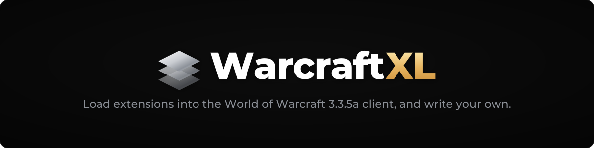
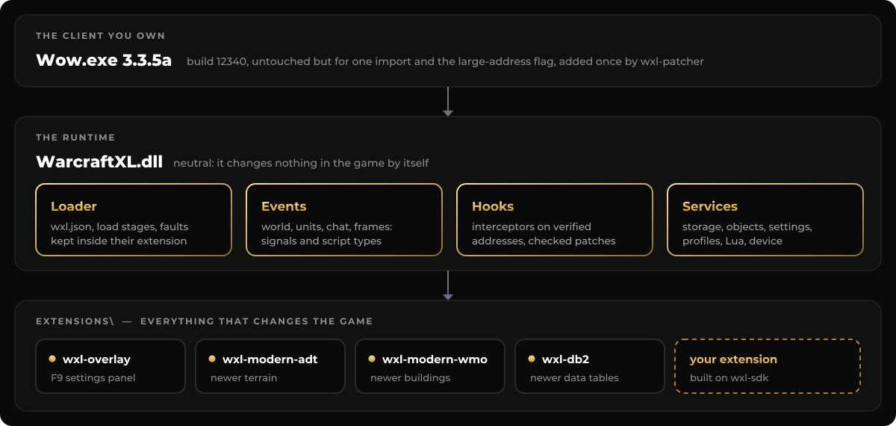

<div align="center">



[](LICENSE)
[](#-install)
[](https://github.com/WarcraftXL/wxl-sdk)
[](#-build-from-source)

[Install](#-install) · [Write an extension](#%EF%B8%8F-write-an-extension) · [Build](#-build-from-source) · [Troubleshooting](#-troubleshooting)

</div>

---

## ✨ What it is

WarcraftXL is the runtime that sits between the game and the extensions you install. On its own it
changes nothing in the game: it loads the extensions in `Extensions\`, gives them events, hooks and
services, and keeps a fault in one extension from taking the others down.

<p align="center">
  
</p>

- **One folder per extension.** Drop it into `Extensions\` and start the game; remove the folder to
  remove it.
- **Settings in game.** Each extension writes its own `.ini` the first time it runs; `/wxl get` and
  `/wxl set` change them in game, and the overlay (F9) shows them all.
- **Faults stay contained.** An extension that crashes inside a hook or a handler is disabled and named
  in the log; the game and the other extensions keep running.
- **Checked, not trusted.** Every address the runtime uses is verified against the stock `Wow.exe`, and
  a byte patch is refused when the bytes it expects are not there.
- **Light.** No allocation on the hot paths: an event costs about 15 ns per listener.

## 📦 Install

> [!NOTE]
> Work on a copy of the client, and only against a client and a server you may modify and connect to.

1. Download the latest release and copy `WarcraftXL.dll` and `wxl-patcher.exe` next to `Wow.exe`.
2. Run `wxl-patcher.exe Wow.exe` once. It adds one import and the large-address flag to `Wow.exe`, and
   keeps the original as `Wow.exe.orig`.
3. Put the extensions you want in `Extensions\`, one folder each, and start the game.

```
World of Warcraft\
├── Wow.exe
├── WarcraftXL.dll
├── wxl-patcher.exe
├── Extensions\
│   ├── wxl-overlay\
│   │   ├── wxl-overlay.dll
│   │   └── wxl.json
│   └── …
└── Logs\wxl-core.log
```

## 🛠️ Write an extension

Extensions are built against the [WarcraftXL SDK](https://github.com/WarcraftXL/wxl-sdk). Its
[getting started](https://github.com/WarcraftXL/wxl-sdk/blob/main/docs/getting-started.md) takes you
from an empty folder to an extension that loads in the game, and each guide comes with an example that
builds:

```cpp
#include <wxl/wxl.hpp>

using namespace wxl;

// One class per extension: override only the events you need.
class Hello : public Extension
{
    void OnStart() override
    {
        On<TargetChanged>([](auto&) { Log::Info("new target"); });
    }

    void OnWorldEnter(MapId map) override
    {
        Log::Info("entered map {}", map);
    }
};

// The entry points; the name and version come from wxl.json.
Export<Hello> extension;
```

How the runtime works inside, and how to add an event to it: [ARCHITECTURE.md](ARCHITECTURE.md).

## ⚡ Build from source

The client is a 32-bit process: everything builds for Win32, with C++20 and CMake 3.20 or later. The
core needs the SDK, installed (`find_package(WarcraftXL 1.3)` through `CMAKE_PREFIX_PATH`) or as a
working copy (`-DWXL_SDK_DIR=<wxl-sdk>`).

<details open>
<summary><b>Windows</b> (Visual Studio 2022)</summary>

```sh
cmake -S . -B build -A Win32 -DWXL_SDK_DIR=../wxl-sdk
cmake --build build --config Release
ctest --test-dir build -C Release
```

`build.ps1 [-ClientPath <client>] [-Test] [-AutoPatch]` does the same and copies the result into a client.
</details>

<details>
<summary><b>Linux</b> (clang-cl or mingw-w64, tests under wine)</summary>

```sh
./build.sh --sdk ../wxl-sdk [--client <client>] [--test] [--autopatch]
```

With a toolchain file for 32-bit Windows: clang-cl with the MSVC CRT and SDK, or
`cmake/toolchain/mingw-i686.cmake`, used when `CMAKE_TOOLCHAIN_FILE` is not set. The tests are Windows
programs: set `CMAKE_CROSSCOMPILING_EMULATOR` to a wrapper that runs `wine <exe> <args>` before
configuring, and ctest runs them through it.
</details>

The tests cover the loader, fault isolation, objects, the event bus, patches, settings and the client
seams; `bench` prints the cost of one dispatch and fails if one allocates per call.

## 🩺 Troubleshooting

| Symptom | Look at |
|---|---|
| The game does not start | `Wow.exe` must be patched by this version's `wxl-patcher.exe`: copy `Wow.exe.orig` back over `Wow.exe` and patch again |
| An extension does not load | `Logs\wxl-core.log` names every extension with the reason it was refused |
| An extension stopped working mid-game | the log names the extension, the hook or handler that faulted, and what was disabled |
| The game crashed | `Errors\` holds the client's crash report; the last lines of `Logs\wxl-core.log` say what ran last |

The core's own options are environment variables or `WarcraftXL.cfg` next to `Wow.exe`:
[WarcraftXL.cfg.example](docs/WarcraftXL.cfg.example).

## 🤝 Contributors

Thanks to everyone who has helped shape WarcraftXL, with code, reverse-engineering, ideas, or feedback:

- [Furioz](https://github.com/Furioz420)
- [Tester](https://github.com/TesterWoWDev)
- [Duskhaven](https://git.duskhaven.net/Duskhaven)

## 💜 Support

Sponsoring is optional.

<p align="center">
  <a href="https://github.com/sponsors/iThorgrim"></a>
</p>

## ⚖️ Legal

WarcraftXL is an **interoperability project**. It distributes no Blizzard code and no game assets, and
runs only against a client you supply and own, reading that client's own files at runtime.
Reverse-engineering is limited to what is necessary for interoperability.

World of Warcraft and Wrath of the Lich King are trademarks of Blizzard Entertainment. This project is
not affiliated with or endorsed by Blizzard.

## 📄 License

Released under the **GNU General Public License v3.0** - see [LICENSE](LICENSE).

Bundles [MinHook](https://github.com/TsudaKageyu/minhook) (© Tsuda Kageyu, BSD 2-Clause) under `deps/`,
with its license retained.
